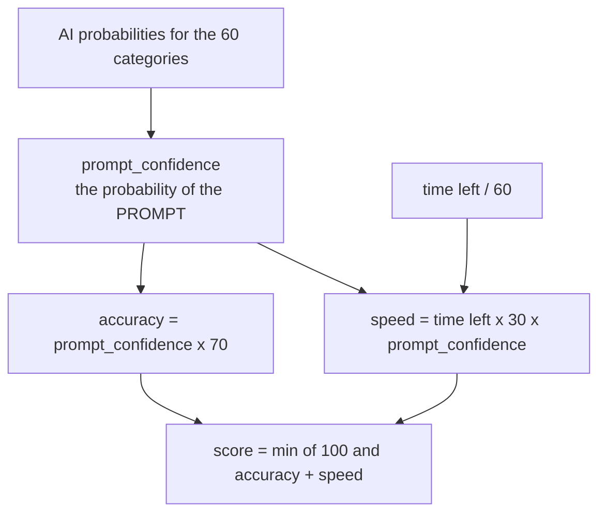
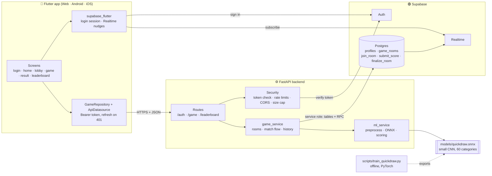
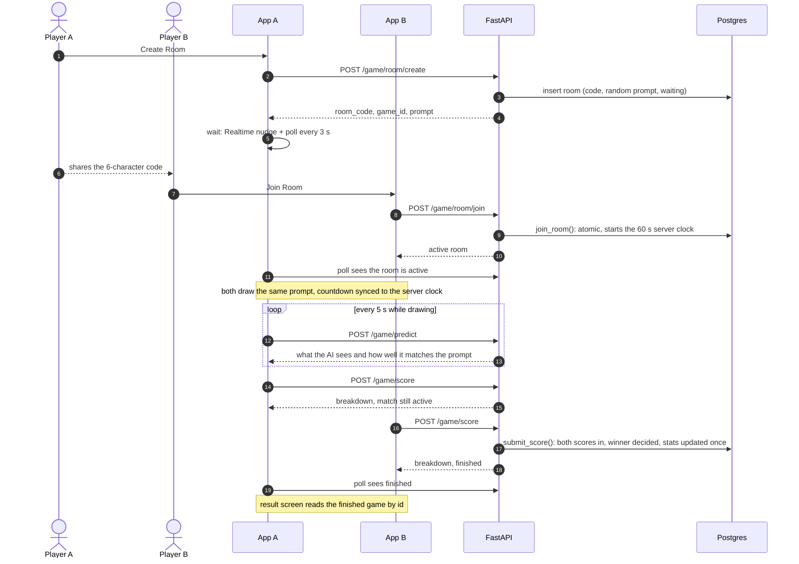
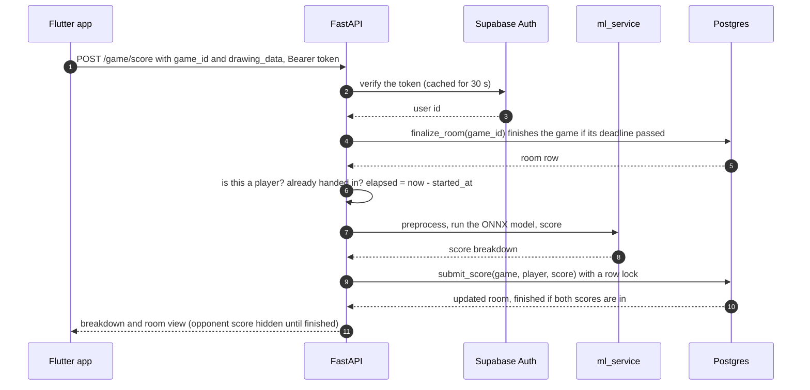
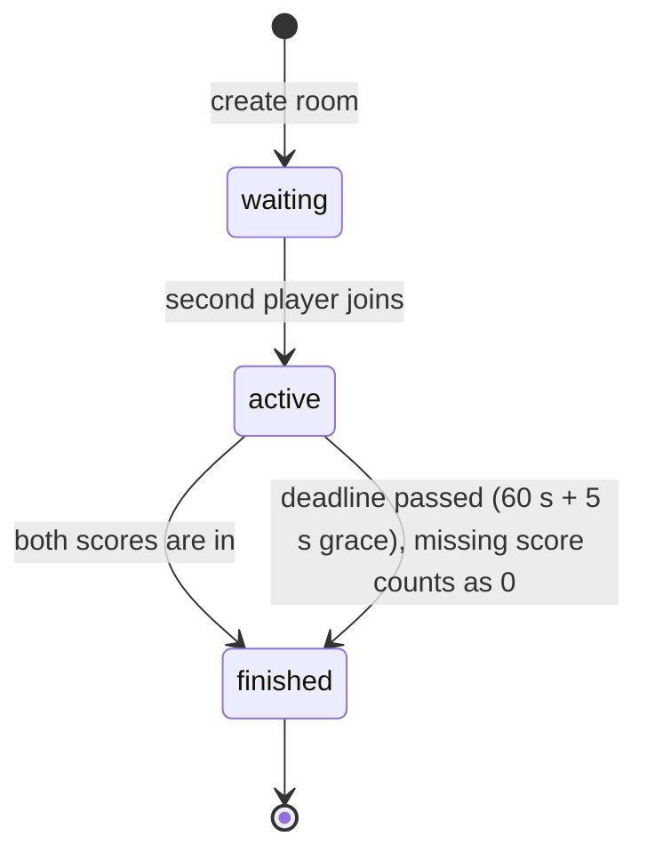
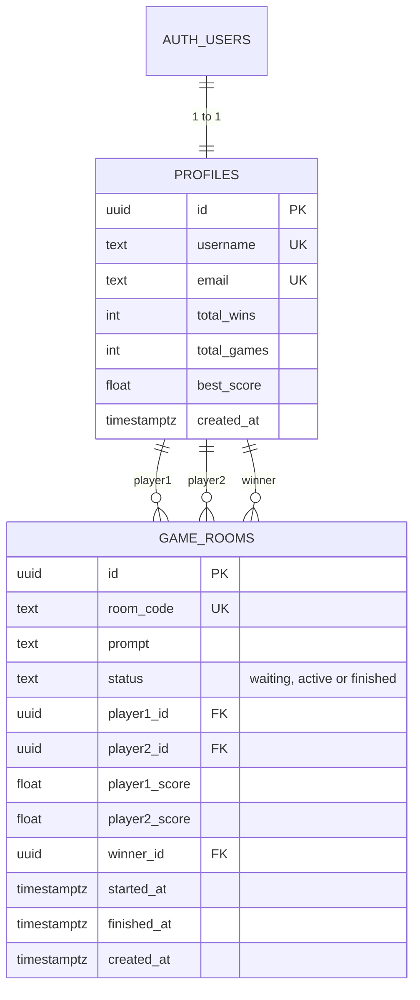
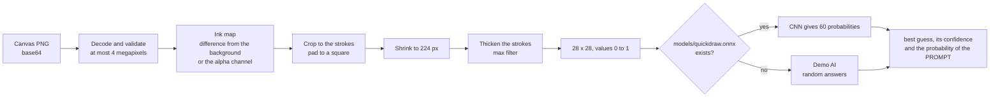
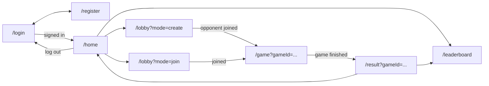

<div align="center">

# SketchDuel ✏️⚔️

**Two players get the same prompt. An AI judges who drew it best.**


*Draw fast. Draw clearly. Let the machine decide.*

</div>

---

## Table of Contents

1. [Overview](#1-overview)
2. [How the game works](#2-how-the-game-works)
3. [Architecture](#3-architecture)
4. [Tech stack](#4-tech-stack)
5. [Project structure](#5-project-structure)
6. [Getting started](#6-getting-started)
7. [Configuration](#7-configuration)
8. [API reference](#8-api-reference)
9. [Database and security](#9-database-and-security)
10. [The AI model](#10-the-ai-model)
11. [Testing and verification](#11-testing-and-verification)
12. [Deployment](#12-deployment)
13. [Known limitations](#13-known-limitations)
14. [Troubleshooting](#14-troubleshooting)
15. [Roadmap](#15-roadmap)
16. [Contributing, license and credits](#16-contributing-license-and-credits)

---

## 1. Overview

SketchDuel is a **two-player drawing game with an AI judge**. One player creates a room and shares a 6-character code, the other joins, and both get the **same prompt** (for example *"umbrella"*) and **60 seconds** to sketch it. Each drawing is sent to the server, shrunk to the 28 x 28 format of Google's [Quick, Draw!](https://quickdraw.withgoogle.com/data) dataset, and shown to a small neural network. The more sure the network is that your picture is the prompt, the higher you score. Speed adds a bonus, but only on drawings the AI actually recognises.

| | |
|---|---|
| 🎮 **Room-code multiplayer** | No matchmaking server: create a room, send the code to a friend. |
| 🤖 **A real AI judge** | A 60-category CNN served with ONNX Runtime. About **83 %** of held-out human drawings are recognised on the first guess, **94 %** within three guesses (see [section 10](#10-the-ai-model)). |
| ⏱️ **Server-authoritative** | The server owns the clock, the prompt, the scoring and the winner. The app cannot send its own score, time or player id. |
| 🔒 **Hardened backend** | Every request is checked against a Supabase token, rate-limited and size-capped. Browsers cannot write to the database. |
| 📱 **One Flutter codebase** | Web, Android and iOS from the same code. |
| 🧪 **Tested** | 109 backend tests and 78 Flutter tests, plus a one-command verification script. |

---

## 2. How the game works

1. **Create / join.** Player A creates a room and gets a code such as `TQXRMV`. Player B enters it. Joining starts a **60-second server clock** for both.
2. **Draw.** Both see the same prompt, drawn from 45 everyday objects. While you draw, a **live bar** shows what the AI currently sees and how well it matches your prompt (refreshed every 5 seconds).
3. **Submit.** Press *Submit*, or let the timer run out (the app submits automatically). You can submit once.
4. **Result.** When both drawings are in, or when the deadline passes (60 s plus 5 s grace for slow networks), the match ends. A player who never submits scores 0. The higher score wins and **equal scores are a draw**.

### Scoring

```
score = prompt_confidence × (70 + 30 × time_left / 60)        (maximum 100)
```

* `prompt_confidence` is how sure the AI is that your drawing is **the prompt**, not merely how sure it is about whatever it likes best.
* Speed is scaled by accuracy, so a fast scribble earns almost nothing.
* A blank canvas, or a submission after the deadline, scores 0.



| Example | prompt_confidence | Time used | Score |
|---|---|---|---|
| A clear cat, the AI is 85 % sure it is a cat | 0.85 | 6 s | **82.45** |
| A decent cat, 60 % sure | 0.60 | 30 s | **51.00** |
| A drawing the AI reads as a dog, only 12 % sure it is a cat | 0.12 | 10 s | **11.40** |
| A butterfly drawn for the prompt "cat" (the AI loves butterflies, 99 %) | 0.00 | 1 s | **0.00** |

The last row is deliberate: drawing something easy to recognise instead of the prompt cannot pay.

<details>
<summary><b>The 45 prompts</b></summary>

apple, bicycle, bird, book, bridge, butterfly, cake, car, cat, clock, cloud, coffee cup, crown, dog, dolphin, elephant, eye, fish, flower, frog, guitar, hammer, hand, hat, house, ice cream, key, light bulb, lion, moon, mountain, mushroom, octopus, pencil, pizza, rabbit, shoe, snake, star, sun, tree, truck, umbrella, whale, zebra

</details>

<details>
<summary><b>The 60 categories the AI knows</b></summary>

apple, banana, bicycle, bird, book, bridge, bus, butterfly, cake, car, cat, chair, clock, cloud, coffee cup, computer, crown, cup, dog, dolphin, door, elephant, eye, face, fish, flower, frog, guitar, hammer, hand, hat, helicopter, house, ice cream, key, laptop, leaf, light bulb, lion, moon, mountain, mushroom, octopus, pencil, pizza, rabbit, shoe, snake, star, sun, sword, table, telephone, tree, truck, umbrella, violin, whale, windmill, zebra

</details>

Every prompt is one of the model's categories, and the server refuses to start if that ever stops being true.

---

## 3. Architecture

SketchDuel is a classic **client / API / backend-as-a-service** design. The Flutter app talks to the FastAPI service for everything about a game, and to Supabase directly only for signing in and for realtime nudges. The API talks to Postgres with the service-role key and runs the AI model in-process.

### 3.1 System overview



### 3.2 A whole match, step by step



### 3.3 What happens on one `POST /game/score`



### 3.4 Game states



The transitions are single database operations (`join_room`, `submit_score`, `finalize_room`) that lock the room row, so two players can never both "win the join" and a match is never finished or counted twice, even if both players submit in the same millisecond.

### 3.5 Data model



### 3.6 From canvas to AI verdict



### 3.7 Screens



The router sends logged-out users to `/login` and reacts to sign-outs and expired sessions automatically. `/game` and `/result` need only a game id, so reloading the page mid-game resumes the round.

### 3.8 Design decisions

| Decision | Why |
|---|---|
| **The server owns the truth** (clock, prompt, scores, winner) | The client can only upload pixels. It cannot forge a time, a prompt, a player id or a score. |
| **Atomic SQL functions for game transitions** | Row locks make joining and finishing race-free, and stats are incremented exactly once. |
| **Realtime is only a nudge** | The app re-reads the game through the API after every nudge and also polls every 3 s, so a dropped WebSocket costs at most a few seconds. |
| **Opponent's score hidden until the end** | The API masks it while the match is active, so you cannot aim for a number you can see. (See the caveat in [section 13](#13-known-limitations).) |
| **ONNX Runtime for inference** | Light, CPU-only, installs everywhere (including a free Render instance). PyTorch is needed only to *train*. |
| **Labels stored inside the `.onnx` file** | The class order can never get out of sync with the model. |
| **Mock AI fallback** | Without a model file the game still runs with random answers and says so ("Demo AI"). |

---

## 4. Tech stack

| Layer | Technology | Version | Role |
|---|---|---|---|
| App | Flutter / Dart | Flutter 3.38, Dart `^3.10.7` | Web, Android, iOS from one codebase |
| App routing | `go_router` | `^17.2.3` | Routes and the auth redirect |
| App backend SDK | `supabase_flutter` | `^2.12.4` | Sign-in session and Realtime |
| App HTTP | `http` | `^1.6.0` | Calls to the API |
| App UI | `google_fonts`, `flutter_animate`, `percent_indicator` | `^8.1.0`, `^4.5.2`, `^4.2.5` | Theme, animation, confidence bar |
| API | FastAPI + Uvicorn | `0.115.12` / `0.34.2` | REST API |
| API validation | Pydantic + pydantic-settings | `2.11.5` / `2.9.1` | Schemas, configuration |
| API database client | `supabase` (supabase-py) | `2.4.6` | Postgres (PostgREST + RPC) and Auth |
| API imaging | Pillow, NumPy | `>=10.4,<12`, `>=2.0` | Decode and preprocess drawings |
| AI inference | ONNX Runtime | `>=1.19,<2` | Runs the classifier on the CPU |
| AI training (offline) | PyTorch, ONNX | `>=2.4`, `>=1.16` | `scripts/train_quickdraw.py` only |
| Data | Supabase Postgres, Auth, Realtime | Free tier | Profiles, games, sign-in, nudges |
| Hosting (optional) | Render (API), Vercel (web build) | Free tiers | See [section 12](#12-deployment) |

---

## 5. Project structure

```
sketchduel/
├── README.md
├── .gitignore
├── scripts/
│   └── verify.ps1                       # lint + all tests, backend and Flutter, in one command
├── backend/                             # FastAPI service
│   ├── .env.example                     # copy to .env (the real .env is never committed)
│   ├── requirements.txt                 # runtime dependencies
│   ├── requirements-dev.txt             # + pytest, ruff
│   ├── requirements-train.txt           # + PyTorch, ONNX (training only)
│   ├── pytest.ini
│   ├── render.yaml                      # Render deployment blueprint
│   ├── migrations/
│   │   ├── 001_init.sql                 # tables, base policies, realtime publication
│   │   └── 002_atomic_scoring_and_timer.sql   # server clock, atomic game functions, locked-down access
│   ├── models/
│   │   ├── quickdraw.onnx               # the trained classifier (committed so deploys can serve it)
│   │   └── quickdraw.metrics.json       # how it was trained and its validation accuracy
│   ├── scripts/
│   │   ├── train_quickdraw.py           # download data, train, export ONNX
│   │   ├── evaluate_model.py            # measure accuracy on canvas-style drawings (+ --tune)
│   │   └── live_smoke_test.py           # play a whole match against your real Supabase project
│   ├── tests/                           # 109 tests with an in-memory Supabase fake
│   │   ├── conftest.py
│   │   ├── test_scoring.py
│   │   ├── test_preprocess.py
│   │   └── test_game_service.py
│   └── app/
│       ├── main.py                      # app, CORS, size guard, health checks
│       ├── api/routes/                  # auth.py · game.py · leaderboard.py
│       ├── core/                        # config.py · supabase.py · security.py · rate_limit.py
│       ├── models/                      # game.py · user.py   (Pydantic schemas)
│       └── services/
│           ├── game_service.py          # rooms, match flow, history, leaderboard
│           └── ml_service.py            # preprocessing, ONNX inference, scoring
└── frontend/                            # Flutter app
    ├── env.example.json                 # copy to env.json (git-ignored)
    ├── pubspec.yaml
    ├── test/                            # 78 tests: models, clock, API client, widgets
    └── lib/
        ├── main.dart                    # start-up, router, error screen
        ├── core/                        # constants/ · theme/ · utils/supabase_client.dart
        ├── data/                        # datasources/ · models/ · repositories/
        └── features/
            ├── auth/screens/            # login · register
            ├── home/screens/
            ├── leaderboard/screens/
            └── game/
                ├── game_clock.dart      # countdown synced to the server clock
                ├── screens/             # lobby · game · result
                └── widgets/             # drawing_canvas · prompt_card · ai_score_bar
```

---

## 6. Getting started

### Prerequisites

| Tool | Version | Notes |
|---|---|---|
| Python | 3.11 or newer | developed on 3.13 |
| Flutter | with Dart `>= 3.10.7` | developed on Flutter 3.38; run `flutter doctor` |
| Git | any recent | |
| Supabase account | free | <https://supabase.com> |

The commands below are for **Windows PowerShell**. On macOS/Linux use `source venv/bin/activate` and `cp` instead of `.\venv\Scripts\...` and `copy`. The helper `scripts/verify.ps1` expects the Windows virtualenv layout.

### 6.1 Get the code

```powershell
git clone https://github.com/MuaazTasawar/sketchduel.git
cd sketchduel
```

### 6.2 Create the Supabase project

1. Create a new project at <https://supabase.com>.
2. **Settings → API Keys → the "Legacy anon, service_role API keys" tab.** Copy the **Project URL**, the **anon** key and the **service_role** key. Use the *legacy* keys (they start with `eyJ`): the pinned `supabase` Python library rejects the newer `sb_publishable_…` / `sb_secret_…` keys with `Invalid API key`.
3. **Authentication → Sign In / Providers → Email:** make sure **Enable email provider** is on and switch **Confirm email** off for development (otherwise every test account needs a real inbox; the exact location of that switch varies slightly between dashboard versions).
4. **SQL Editor:** run `backend/migrations/001_init.sql`, then `backend/migrations/002_atomic_scoring_and_timer.sql`. Both are safe to run again. This PowerShell snippet puts both on your clipboard and opens the editor:

```powershell
$ref = "<your-project-ref>"   # the xxxx in https://xxxx.supabase.co
$sql = (Get-Content .\backend\migrations\001_init.sql -Raw) + "`n`n" + (Get-Content .\backend\migrations\002_atomic_scoring_and_timer.sql -Raw)
$sql | Set-Clipboard
Start-Process "https://supabase.com/dashboard/project/$ref/sql/new"   # paste with Ctrl+V and press Run
```

### 6.3 Run the backend

```powershell
cd backend
python -m venv venv
.\venv\Scripts\python.exe -m pip install -r requirements-dev.txt
copy .env.example .env            # then fill in the three Supabase values
.\venv\Scripts\python.exe -m uvicorn app.main:app --reload --host 0.0.0.0 --port 8000
```

Open <http://localhost:8000/docs> for the interactive API documentation, or <http://localhost:8000/health>.

Check the whole stack against your real Supabase project (creates two temporary players, plays a match, deletes them):

```powershell
.\venv\Scripts\python.exe scripts\live_smoke_test.py --check-settings   # only reads your auth settings
.\venv\Scripts\python.exe scripts\live_smoke_test.py                    # the full match
```

### 6.4 Run the app

```powershell
cd frontend
copy env.example.json env.json     # then fill in SUPABASE_URL, SUPABASE_ANON_KEY and API_BASE_URL
flutter pub get
flutter run -d chrome --dart-define-from-file=env.json
```

If you forget `--dart-define-from-file=env.json`, the app opens a screen that tells you exactly what is missing instead of crashing.

| Where the app runs | `API_BASE_URL` |
|---|---|
| Chrome on the same PC | `http://localhost:8000/api/v1` |
| Android emulator | `http://10.0.2.2:8000/api/v1` |
| A phone on your Wi-Fi | `http://<your-pc-ip>:8000/api/v1` (start uvicorn with `--host 0.0.0.0` and allow it through the firewall) |

Android blocks plain `http://` traffic by default, so testing a real phone against a local API needs a cleartext / network-security configuration in the Android project. This repo's `android/` folder contains one for LAN development (see `app/src/main/AndroidManifest.xml` and `res/xml/network_security_config.xml`): remove it before shipping a release build.

### 6.5 Play a match locally

You need two players, so use two separate sessions (a normal window and an incognito window, or two browsers):

1. Register two accounts, then log in on each.
2. Window A: **Create Room**, copy the code. Window B: **Join Room**, enter it.
3. Both land on the same prompt with a synced countdown. Draw. After a few seconds the live bar appears.
4. Submit in both windows. Both result screens show the winner, both scores and (for you) how your score was made.

Things worth trying: refresh the page mid-round (the round resumes with the right time left), or let one player never submit (the other gets a result about 65 seconds after the game started).

---

## 7. Configuration

### Backend: `backend/.env`

| Variable | Required | Default | Purpose |
|---|---|---|---|
| `SUPABASE_URL` | yes | | Project URL |
| `SUPABASE_KEY` | yes | | **anon** key (used only for sign-up and sign-in) |
| `SUPABASE_SERVICE_KEY` | yes | | **service_role** key. Secret. Never ship it in the app. |
| `SECRET_KEY` | no | empty | Reserved. Tokens are verified by Supabase, not signed by this API. |
| `ENVIRONMENT` | no | `development` | `production` turns off the automatic `localhost` CORS rule |
| `ALLOWED_ORIGINS` | in production | empty | Comma-separated browser origins, e.g. `https://sketchduel.vercel.app` |
| `MODEL_PATH` | no | `models/quickdraw.onnx` | Where the classifier lives (relative to `backend/`) |
| `DRAWING_SECONDS` | no | `60` | Length of the drawing phase |
| `SUBMIT_GRACE_SECONDS` | no | `5` | Extra seconds allowed for slow networks |
| `MAX_DRAWING_BYTES` | no | `2000000` | Largest accepted drawing upload |
| `RATE_LIMIT_PER_MINUTE` | no | `30` | Default per-user limit (endpoints below set their own) |

### App: `frontend/env.json` (passed with `--dart-define-from-file`)

| Key | Purpose |
|---|---|
| `SUPABASE_URL` | Project URL |
| `SUPABASE_ANON_KEY` | **anon** key. It is designed to be public: the database rules, not secrecy, protect your data. |
| `API_BASE_URL` | Where the FastAPI service is, ending in `/api/v1` |

`backend/.env` and `frontend/env.json` are git-ignored. Only the `*.example` files are committed.

---

## 8. API reference

Base URL: `http://localhost:8000/api/v1`. Interactive docs at `/docs` (Swagger) and `/redoc`. Outside the prefix: `GET /` and `GET /health`.

Every endpoint except register and login needs `Authorization: Bearer <access token>`. The player is **always** the owner of the token: no endpoint accepts a player id.

| Method | Endpoint | Body / query | Limit | Description |
|---|---|---|---|---|
| `POST` | `/auth/register` | `{email, password (6-72), username (3-20, letters digits _)}` | 5/min per IP | Create an account and its profile |
| `POST` | `/auth/login` | `{email, password}` | 10/min per IP | Returns `access_token` (the app signs in with Supabase directly; this exists for tools and scripts) |
| `GET` | `/auth/profile/{user_id}` | | | Public profile (no e-mail) |
| `POST` | `/game/room/create` | | 10/min | New room: `{room_code, game_id, prompt}` |
| `POST` | `/game/room/join` | `{room_code}` | 20/min | Join and start the 60 s clock |
| `GET` | `/game/room/id/{game_id}` | | 90/min | The game as you may see it (players only). Also finishes expired games. |
| `POST` | `/game/score` | `{game_id, drawing_data}` | 10/min | Hand in your drawing (base64 PNG) |
| `POST` | `/game/predict` | `{game_id, drawing_data}` | 30/min | Live preview. Nothing is scored or stored. |
| `GET` | `/game/history` | `?limit=20` (1-100) | 30/min | Your finished games |
| `GET` | `/leaderboard/top` | `?limit=20` (1-100) | 30/min | Players with at least one game, ranked by wins, then best score |

**Errors** come back as `{"detail": "..."}`: `400` unreadable drawing · `401` missing or expired token · `404` unknown game, or you are not a player in it · `409` conflict (own room, room full, game not started) · `413` body too large · `422` invalid input (a list of field problems) · `429` too many requests (with `Retry-After`) · `503` database trouble.

<details>
<summary><b>Example: <code>POST /game/score</code> (Alice hands in first)</b></summary>

```json
{
  "submitted": true,
  "score": 15.22,
  "accuracy_score": 10.66,
  "speed_bonus": 4.56,
  "matched": false,
  "recognized_as": "dog",
  "confidence": 0.74,
  "prompt_confidence": 0.1523,
  "blank": false,
  "late": false,
  "time_taken": 0.1,
  "model": "onnx",
  "status": "active",
  "winner_id": null,
  "is_draw": false,
  "room": {
    "id": "0dccf0af-...", "room_code": "TQXRMV", "prompt": "cloud", "status": "active",
    "player1_score": 15.22, "player2_score": null,
    "is_player1": true, "seconds_remaining": 59.9, "time_limit_seconds": 60
  }
}
```

Here the AI was 74 % sure the drawing was a dog but only 15 % sure it was the prompt (a cloud), so the score is low. Bob's score is hidden until the match finishes. Handing in again returns `"submitted": false` and changes nothing.
</details>

<details>
<summary><b>Example: <code>POST /game/predict</code> (the live bar)</b></summary>

```json
{
  "recognized_as": "cloud",
  "confidence": 0.9058,
  "prompt_confidence": 0.9058,
  "matches_prompt": true,
  "blank": false,
  "model": "onnx",
  "seconds_remaining": 41.2
}
```
</details>

<details>
<summary><b>Example: <code>GET /leaderboard/top</code></b></summary>

```json
[
  {"rank": 1, "username": "alice", "total_wins": 1, "total_games": 1, "win_rate": 100.0, "best_score": 79.29},
  {"rank": 2, "username": "bob",   "total_wins": 0, "total_games": 1, "win_rate": 0.0,   "best_score": 61.92}
]
```
</details>

---

## 9. Database and security

### Tables

`profiles` (one row per player: username, e-mail, wins, games, best score) and `game_rooms` (the games). See the diagram in [section 3.5](#35-data-model). `migrations/002` adds the server clock columns (`started_at`, `finished_at`), constraints and indexes.

### The game functions (callable only by the backend)

| Function | What it does |
|---|---|
| `join_room(code, player)` | Joins a waiting room atomically (not your own, not full) and starts the clock |
| `submit_score(game, player, score, limit)` | Records one player's score once; finishes the match if possible |
| `finalize_room(game, limit)` | Finishes a game if both scores are in or the deadline passed; a missing score counts as 0; equal scores are a draw; stats are updated exactly once |

### What protects the data

* **The app never writes to the database.** Insert/update/delete rights on both tables are revoked for the public (`anon`) and logged-in (`authenticated`) roles. All writes go through the API with the service-role key.
* **The three game functions are executable by `service_role` only.** A browser calling them with the public key is refused.
* **E-mail addresses are not readable** with the public key (column-level grants expose only username, wins, games and best score).
* **Every API request is authenticated** against Supabase; identities come from the verified token, never from the request body.
* **Server-side truth:** prompt, elapsed time, winner and scores are decided on the server.
* **Abuse limits:** per-user and per-IP rate limits, a request-size cap, strict CORS (no wildcard; in development only `localhost` origins are allowed automatically), a cap on image size to avoid decompression bombs, and generic error messages for failed logins.
* **Secrets:** `backend/.env` is git-ignored, and `scripts/verify.ps1` fails if it ever becomes tracked. If a service-role key was ever pushed to a public repo, rotate it in the Supabase dashboard.

---

## 10. The AI model

### What it is

A small convolutional network (three conv blocks, about 0.4 M parameters, a 1.6 MB `.onnx` file) trained on **60 Quick, Draw! categories** at 28 x 28 pixels. It outputs a probability for each category. The category names are stored inside the model file.

### From your canvas to the model

Players draw thin white strokes on a large dark canvas, but the model was trained on small, centred, fairly thick QuickDraw bitmaps. `ml_service.py` bridges the gap (diagram in [section 3.6](#36-from-canvas-to-ai-verdict)): it finds the strokes (white-on-dark, black-on-white and transparent canvases all work), crops to their bounding box, centres them in a square, shrinks to 224 px, thickens the strokes, and scales to 28 x 28. In measurements during development this took about **20 ms** per drawing on a laptop-class CPU, regardless of canvas size. An empty canvas is detected and scores 0.

### How good is it?

Measured with `scripts/evaluate_model.py`: real human strokes from the dataset (drawings the model never saw), drawn on a canvas the way the app draws them, then run through the full pipeline. 2,400 drawings, 40 per category:

| Metric | Result |
|---|---|
| Top-1 accuracy (first guess is right) | **83.2 %** |
| Top-3 accuracy | **93.7 %** |
| Top-1 on the 45 game prompts only | **84.1 %** |

Strongest: chair, butterfly, bicycle (≈ 98-100 %). Weakest, with the usual confusion: violin → guitar (52 %), dog → elephant (55 %), cup → coffee cup (58 %), frog → lion (60 %), leaf → pencil (60 %). The preprocessing settings were checked with `--tune`; the defaults were the best of eight combinations tried. These strokes are clean vector drawings: shaky finger-drawn lines on a phone will do somewhat worse.

### Train your own

```powershell
cd backend
.\venv\Scripts\python.exe -m pip install -r requirements-train.txt
.\venv\Scripts\python.exe scripts\train_quickdraw.py --smoke-test        # ~1 minute, fake data: checks your setup
.\venv\Scripts\python.exe scripts\train_quickdraw.py --samples-per-class 2000 --epochs 5   # real run
.\venv\Scripts\python.exe scripts\evaluate_model.py                     # how good is it on canvas-style drawings?
.\venv\Scripts\python.exe scripts\evaluate_model.py --tune              # also try other preprocessing settings
```

The training script downloads only the rows it needs (HTTP range requests, a few hundred MB at most), checks that every category exists in the dataset, exports `models/quickdraw.onnx` with the labels embedded, and verifies the exported file against PyTorch. Delete the file after a `--smoke-test`: it is trained on fake data. `models/quickdraw.metrics.json` records the settings and validation accuracy of the last real run. Restart the API after replacing the model.

---

## 11. Testing and verification

One command runs everything:

```powershell
.\scripts\verify.ps1               # ruff + pytest + flutter pub get/analyze/test + a check that .env is untracked
.\scripts\verify.ps1 -Backend      # backend only
.\scripts\verify.ps1 -Flutter      # Flutter only
.\scripts\verify.ps1 -Live         # also plays a real match against your Supabase project
```

| Suite | Tests | What it covers |
|---|---|---|
| Backend (`pytest`) | 109 | scoring rules and the "easy drawing" exploit, preprocessing (any polarity, size, transparency, bad input, speed), ONNX loading and fallbacks, room creation/joining, forfeits, draws, resubmits, hidden scores, history, leaderboard, auth, rate limits, size cap |
| Flutter (`flutter test`) | 78 | models parsed from **real server responses**, the server-synced countdown, the API client (token, 401 refresh and retry, error messages, timeouts), the repository, the drawing canvas (gestures, multi-touch, PNG export) and the live bar |

The backend tests never touch your real Supabase project: dummy settings are forced into the environment and the database is replaced by an in-memory fake that mirrors the SQL functions.

---

## 12. Deployment

> The steps below follow the project's configuration files but have **not been exercised end-to-end** by the test suite. Treat them as a starting point.

**API → Render (free).** `backend/render.yaml` describes the service (root `backend`, Python 3.12, health check `/health`). Create a Web Service from the repo, then set `SUPABASE_URL`, `SUPABASE_KEY`, `SUPABASE_SERVICE_KEY`, `ENVIRONMENT=production` and `ALLOWED_ORIGINS` (your web app's origin). Make sure `backend/models/quickdraw.onnx` is committed, otherwise the server runs the demo AI. The free tier sleeps when idle, so the first request after a break can take about 30 seconds.

**Web app → Vercel (or any static host).** Put your public API URL in `env.json`, then:

```powershell
cd frontend
flutter build web --release --dart-define-from-file=env.json
# upload build/web to your static host
```

**Mobile.** Set `API_BASE_URL` to the public HTTPS URL, remove the cleartext-HTTP allowance from the Android project, and build with `flutter build apk --dart-define-from-file=env.json`.

---

## 13. Known limitations

An honest list of what is not done or not covered:

* **The opponent's score can be seen by a determined player.** The API hides it until the match ends, but the raw database row that Supabase Realtime delivers to both players while the game is active still contains both scores. The app ignores it (it re-reads through the API), but someone inspecting network traffic could see it. The proper fix is to keep submitted scores in a private table until the match finishes (not implemented).
* **Accuracy on real finger drawings is unmeasured.** The 83 % figure uses clean dataset strokes rendered by code.
* **The SQL functions, Realtime and the lobby, game and result screens are not covered by automated tests in this repository.** The SQL was validated against a real PostgreSQL during development and the screens were verified by hand, but there is no repeatable test for them.
* **Rate limiting is in-memory**, so it applies per API instance. Run more than one instance and you need a shared store.
* **Abandoned waiting rooms are never cleaned up** (they are harmless rows), and the registration screen's text still says "check your email" even when confirmation is off.
* **Scores from games played under earlier scoring rules** stay in the database, so "best score" on the leaderboard may mix scales until old test accounts are removed.
* **Deployment is untested** (see [section 12](#12-deployment)).

---

## 14. Troubleshooting

| Symptom | Fix |
|---|---|
| `Invalid API key` when the API starts | Use the **legacy** `eyJ…` anon and service_role keys (section 6.2), not the new `sb_…` keys. |
| `Field required` errors for `SUPABASE_URL` etc. | `backend/.env` is missing or empty. Copy `.env.example` and fill it in. |
| The app shows "SketchDuel can't start" | Run it with `--dart-define-from-file=env.json` and fill in `env.json`. |
| `relation "game_rooms" does not exist` | Run `001_init.sql` before `002_...sql`, in the Supabase SQL editor. |
| Registration says the e-mail is invalid or sign-up is disabled | Turn **Enable email provider** on. Use a real-looking address: Supabase rejects domains such as `example.com`. |
| Login says "Email not confirmed" | Switch **Confirm email** off (development), or confirm the address from the e-mail. |
| "Your session has expired" | Log in again. The app already retries once with a refreshed token. |
| Live bar says "Demo AI: the real model is not trained yet" | `backend/models/quickdraw.onnx` is missing or could not be loaded. See section 10, then restart the API. |
| Browser shows a CORS error | In development use a `localhost` origin. In production add the web app's origin to `ALLOWED_ORIGINS`. |
| Android emulator cannot reach the API | Use `http://10.0.2.2:8000/api/v1`. |
| A real phone cannot reach the API | Start uvicorn with `--host 0.0.0.0`, use your PC's LAN IP in `API_BASE_URL`, allow port 8000 through the firewall. |
| `429 Too many requests` | You hit a rate limit. Wait the number of seconds in `Retry-After`. |
| Training stops with "These categories do not exist in the QuickDraw dataset" | A category name in `QUICKDRAW_CLASSES` is not in Google's list. The message names it. |
| `verify.ps1` says `backend/.env is tracked by git` | `git rm --cached backend/.env`, and rotate your keys if it was ever pushed. |

---

## 15. Roadmap

- [ ] Keep submitted scores private until the match ends (closes the Realtime caveat)
- [ ] Automated tests for the SQL functions (against a throwaway Postgres) and for the lobby, game and result screens
- [ ] Measure accuracy on real finger drawings and, if needed, train with hand-drawn data or augmentation
- [ ] History screen (the `/game/history` endpoint already exists)
- [ ] Clean up abandoned waiting rooms
- [ ] Prompt packs and categories (animals, food, buildings) and a daily challenge
- [ ] Rematch button, spectators, drawing replay
- [ ] Shared rate-limit store for multi-instance deployments

---

## 16. Contributing, license and credits

```powershell
git checkout -b feature/your-change
# ...make your change...
.\scripts\verify.ps1            # must end with "All checks passed"
git commit -m "feat: what you changed"
git push origin feature/your-change   # then open a pull request
```

Style: Python follows PEP 8 and `ruff` must pass; Dart follows `flutter analyze` (clean) and `dart format`; commit messages use [Conventional Commits](https://www.conventionalcommits.org/).

Released under the **MIT License**.

**Credits.** The AI is trained on the [Quick, Draw! dataset](https://github.com/googlecreativelab/quickdraw-dataset) by Google, used under CC BY 4.0. Built with [Flutter](https://flutter.dev), [FastAPI](https://fastapi.tiangolo.com), [Supabase](https://supabase.com), [ONNX Runtime](https://onnxruntime.ai) and [PyTorch](https://pytorch.org).

---

<div align="center">

Made by [@MuaazTasawar](https://github.com/MuaazTasawar) · [Report a bug](https://github.com/MuaazTasawar/sketchduel/issues)

</div>
