<div align="center">

# SketchDuel ✏️⚔️

**A two-player, AI-judged drawing battle. Draw fast, draw smart, and try to fool the machine.**


-orange?style=flat)


*Draw. Bluff. Win.*

</div>

---

## Table of Contents

1. [Overview](#1-overview)
2. [How the Game Works](#2-how-the-game-works)
3. [Architecture](#3-architecture)
   - [System Context](#31-system-context)
   - [Backend Layering](#32-backend-layering)
   - [Frontend Layering](#33-frontend-layering)
   - [Sequence: Auth](#34-sequence-registration--login)
   - [Sequence: Room Creation & Joining](#35-sequence-room-creation--joining)
   - [Sequence: Play, Submit & Score](#36-sequence-play-submit--score)
   - [Room State Machine](#37-room-state-machine)
   - [Screen Navigation](#38-screen-navigation)
   - [Data Model](#39-data-model-er-diagram)
4. [Tech Stack](#4-tech-stack)
5. [Project Structure](#5-project-structure)
6. [Backend Deep Dive](#6-backend-deep-dive)
7. [Frontend Deep Dive](#7-frontend-deep-dive)
8. [The Scoring System](#8-the-scoring-system)
9. [API Reference](#9-api-reference)
10. [Database & Row Level Security](#10-database--row-level-security)
11. [Getting Started](#11-getting-started)
12. [Configuration](#12-configuration)
13. [Deployment](#13-deployment)
14. [Current Status & Known Limitations](#14-current-status--known-limitations)
15. [Security Notes](#15-security-notes)
16. [Troubleshooting](#16-troubleshooting)
17. [Roadmap](#17-roadmap)
18. [Contributing](#18-contributing)
19. [License](#19-license)

---

## 1. Overview

SketchDuel is a **real-time, two-player drawing game** in which a machine-learning model acts as the judge, and, in effect, as a third player you can manipulate.

Both players receive the **same prompt** (for example *"cat"* or *"umbrella"*) and get **60 seconds** to sketch it on a touch/mouse canvas. Each drawing is sent to the backend, converted to the 28×28 grayscale format used by Google's [QuickDraw](https://quickdraw.withgoogle.com/data) dataset, and scored. The higher score wins.

### Highlights

| | |
|---|---|
| 🎮 **Room-code multiplayer** | Create a room, share a 6-character code, friend joins. No matchmaking server needed. |
| 🤖 **ML as a game mechanic** | Score is driven by an AI model's *confidence*, not by human guessing. |
| 🎭 **The Bluff mechanic** | If the AI is confidently *wrong* about your drawing, you earn a bonus. |
| ⚡ **Realtime sync** | Supabase Realtime (Postgres changes over WebSockets) moves both players from lobby → game → result. |
| 📱 **Cross-platform client** | One Flutter codebase for Web, Android and iOS (desktop scaffolding is also present). |
| 💸 **Zero-cost stack** | Supabase free tier + Render free tier + a free open dataset. |

> **Project status:** the full game loop (auth → room → draw → score → winner → leaderboard) is implemented end-to-end. The ML judge is currently a **mock** that simulates a QuickDraw classifier; the real TFLite model is the top roadmap item. See [Current Status & Known Limitations](#14-current-status--known-limitations) for an honest list of what works and what doesn't yet.

---

## 2. How the Game Works

```
  Player 1 creates room ──► 6-char code + random prompt generated
          │
          ▼
  Player 2 enters code ───► room flips  waiting → active
          │
          ▼  (Supabase Realtime pushes the change to Player 1)
  Both players land on the Game Screen with the SAME prompt
          │
          ▼
  60-second countdown · draw on canvas · live "AI sees…" bar
          │
          ▼  (Submit button, or auto-submit when the timer hits 0)
  Canvas → PNG → base64 → POST /game/score
          │
          ▼
  Server: preprocess → classify → score → save to game_rooms
          │
          ├── opponent hasn't submitted ──► "Waiting for opponent…"
          └── both scores present ────────► winner decided, stats updated,
                                            room → finished, Realtime notifies both
          ▼
  Result screen (win / lose + both scores) → Leaderboard
```

### The Bluff Mechanic

Classic drawing games ask a human "what is this?". SketchDuel asks a neural network, and then **rewards you for confusing it**:

- **Draw accurately** → the AI recognises your prompt with high confidence → high *base score*.
- **Draw quickly** → up to **+25** *speed bonus* for unused time.
- **Bluff the AI** → draw something the model confidently labels as *something else* (>60 % confidence, label ≠ prompt) → **+15** *bluff bonus*.

That creates a small meta-game: sometimes the winning move is a deliberately weird drawing.

---

## 3. Architecture

SketchDuel is a classic **client / API / BaaS** design. The Flutter client talks to two backends: Supabase *directly* (auth session + realtime subscriptions) and a FastAPI service (business logic + ML scoring), which in turn persists everything in Supabase Postgres.

### 3.1 System Context

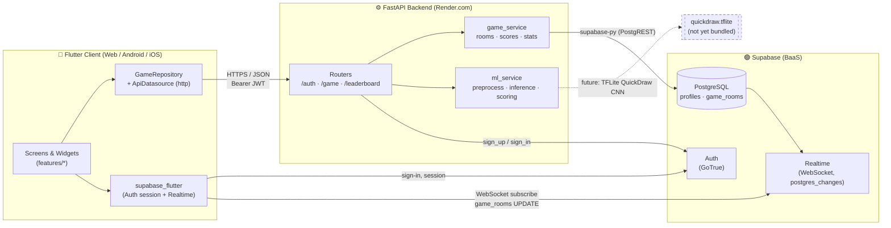

**Key design decisions**

| Decision | Rationale |
|---|---|
| **Realtime via database changes, not custom WebSockets** | The backend never has to hold connections open. It writes to `game_rooms`; Supabase fans the change out to both clients. This is why the free Render tier (which sleeps) is viable. |
| **Server-side scoring** | The client only uploads pixels. Scores are computed on the server so players can't submit their own numbers. |
| **Room code as join key** | A 6-character code (`A–Z`, `0–9`) avoids matchmaking infrastructure and lets friends play instantly. |
| **Winner decided by whoever submits second** | No coordinator/timer service is needed. The second `POST /game/score` finds both scores present and finalises the match. |

### 3.2 Backend Layering

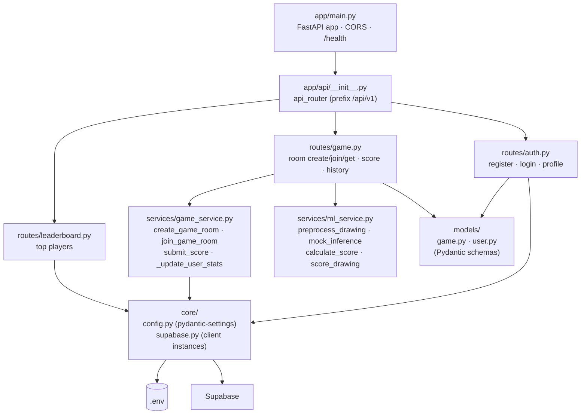

The backend follows a **routes → services → core** layering:

- **Routes** validate input (Pydantic) and translate exceptions into HTTP errors.
- **Services** hold game logic and know nothing about HTTP.
- **Core** owns configuration and the Supabase client singletons.

### 3.3 Frontend Layering

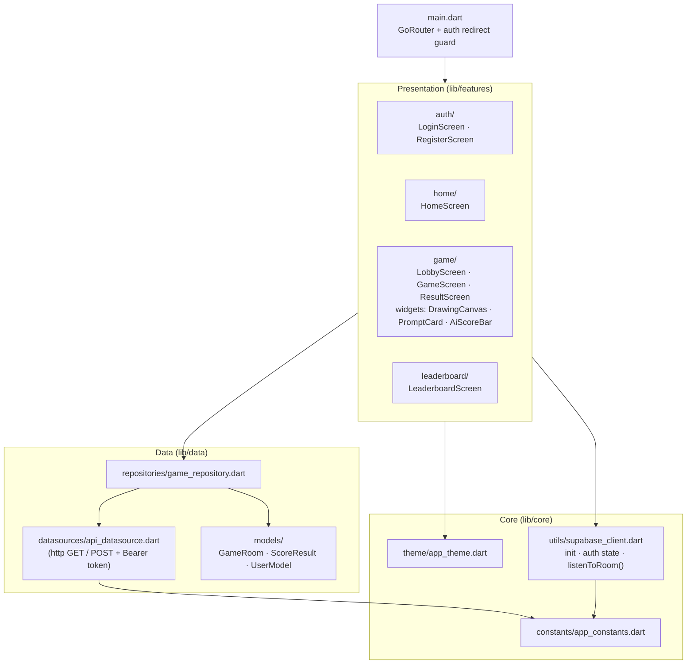

### 3.4 Sequence: Registration & Login

Registration goes through the FastAPI backend (which also creates the `profiles` row). Login goes **directly** to Supabase Auth from the client so that `supabase_flutter` holds the session and can authenticate Realtime.

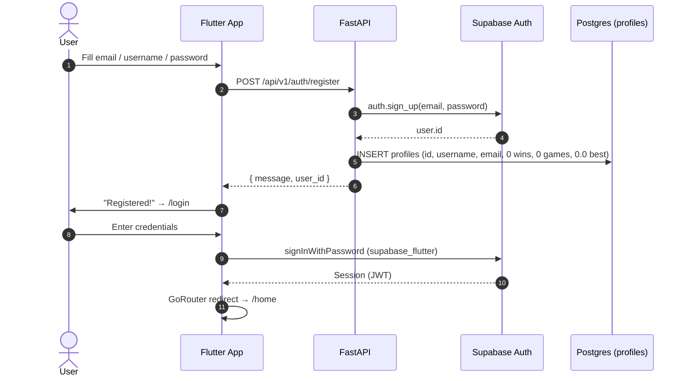

### 3.5 Sequence: Room Creation & Joining

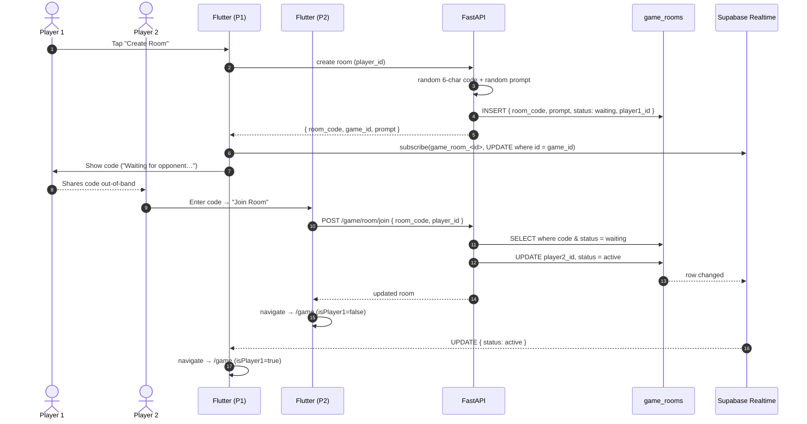

### 3.6 Sequence: Play, Submit & Score

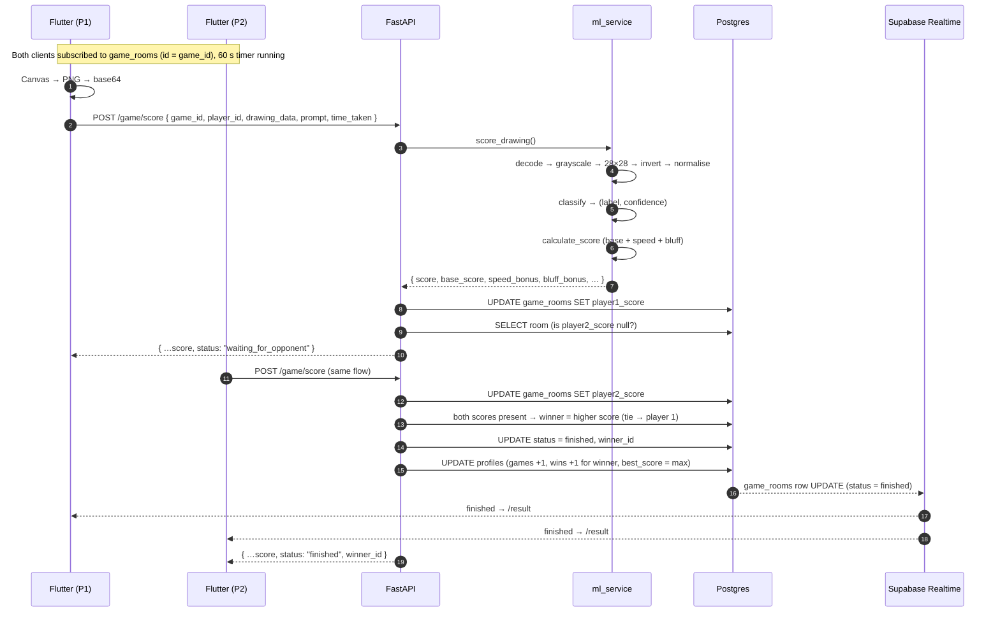

### 3.7 Room State Machine

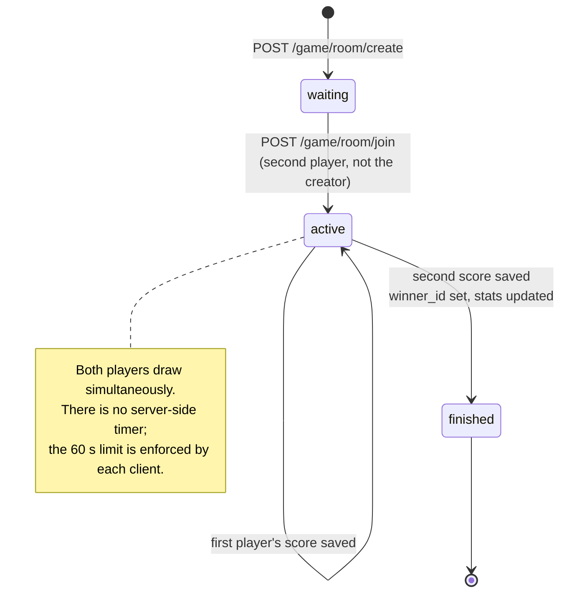

### 3.8 Screen Navigation

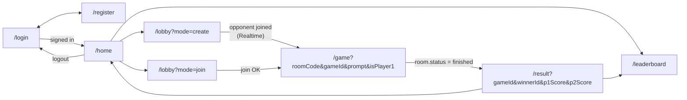

`GoRouter`'s global `redirect` guard sends unauthenticated users to `/login` and authenticated users away from the auth screens.

### 3.9 Data Model (ER Diagram)

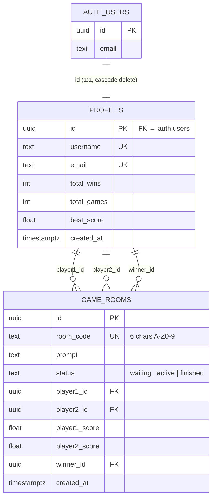

---

## 4. Tech Stack

| Layer | Technology | Version (from the repo) | Role |
|---|---|---|---|
| **Client** | Flutter / Dart | Dart SDK `^3.10.7` | Single codebase for Web, Android, iOS |
| Routing | `go_router` | `^17.2.3` | Declarative routes + auth redirect guard |
| Backend SDK | `supabase_flutter` | `^2.12.4` | Auth session + Realtime subscriptions |
| HTTP | `http` | `^1.6.0` | Calls to the FastAPI backend |
| UI / UX | `google_fonts` (Poppins), `flutter_animate`, `percent_indicator`, `lottie`, `fluttertoast` | — | Dark theme, animations, confidence bar |
| Misc (declared) | `provider`, `shared_preferences`, `flutter_drawing_board`, `uuid`, `image` | — | Present in `pubspec.yaml`; not yet used by the current screens |
| **API** | FastAPI + Uvicorn | `0.115.12` / `0.34.2` | REST API |
| Validation | Pydantic (+ `pydantic-settings`) | `2.x` / `2.9.1` | Schemas, `.env` loading |
| Auth/DB client | `supabase` (supabase-py) | `2.4.6` | PostgREST + Auth |
| Imaging / ML prep | Pillow, NumPy | `10.4.0` / `>=2.0.0` | Decode, resize, normalise drawings |
| **Data** | Supabase PostgreSQL | Free tier (500 MB) | `profiles`, `game_rooms` |
| Realtime | Supabase Realtime | Free tier | `postgres_changes` over WebSocket |
| Auth | Supabase Auth | Free tier | Email + password, JWT sessions |
| ML (planned) | QuickDraw CNN → TFLite | — | Real inference; currently mocked |
| Hosting | Render (API), Vercel (web build) | Free tiers | Deployment |

---

## 5. Project Structure

```
sketchduel/
├── README.md
├── .gitignore
│
├── backend/                              # FastAPI service  (~500 LOC)
│   ├── .env                              # secrets – must NOT be committed
│   ├── render.yaml                       # Render config (currently empty)
│   ├── requirements.txt
│   └── app/
│       ├── main.py                       # FastAPI app, CORS, /, /health, mounts /api/v1
│       ├── api/
│       │   ├── __init__.py               # api_router: includes auth, game, leaderboard
│       │   └── routes/
│       │       ├── auth.py               # /auth/register, /auth/login, /auth/profile/{id}
│       │       ├── game.py               # /game/room/*, /game/score, /game/history/{id}
│       │       └── leaderboard.py        # /leaderboard/top
│       ├── core/
│       │   ├── config.py                 # Settings (pydantic-settings, cached)
│       │   └── supabase.py               # `supabase` (anon) + `supabase_admin` (service role)
│       ├── models/
│       │   ├── game.py                   # GameStatus, DrawingSubmission, GameRoom, …
│       │   └── user.py                   # UserRegister, UserLogin, UserResponse
│       └── services/
│           ├── game_service.py           # prompts, room codes, join, submit_score, stats
│           └── ml_service.py             # preprocess → (mock) inference → scoring
│
└── frontend/                             # Flutter app  (~1.7k LOC Dart)
    ├── pubspec.yaml
    ├── android/  ios/  web/  linux/  windows/  macos/   # platform runners
    ├── test/widget_test.dart
    └── lib/
        ├── main.dart                     # Supabase init, GoRouter, MaterialApp.router
        ├── core/
        │   ├── constants/app_constants.dart   # baseUrl, Supabase keys, timer, endpoints
        │   ├── theme/app_theme.dart           # dark Material 3 theme, palette, Poppins
        │   └── utils/supabase_client.dart     # init, currentUser, listenToRoom()
        ├── data/
        │   ├── datasources/api_datasource.dart     # http GET/POST + Bearer header
        │   ├── models/{game_model,user_model}.dart # GameRoom, ScoreResult, UserModel
        │   └── repositories/game_repository.dart   # createRoom/joinRoom/getRoom/submit/leaderboard
        └── features/
            ├── auth/screens/{login,register}_screen.dart
            ├── home/screens/home_screen.dart
            ├── game/
            │   ├── screens/{lobby,game,result}_screen.dart
            │   └── widgets/{drawing_canvas,prompt_card,ai_score_bar}.dart
            └── leaderboard/screens/leaderboard_screen.dart
```

---

## 6. Backend Deep Dive

### 6.1 Module responsibilities

| Module | Responsibility |
|---|---|
| `main.py` | Creates the app (`title="SketchDuel API"`, `version="1.0.0"`), adds CORS, mounts the router at `/api/v1`, exposes `GET /` and `GET /health`. |
| `core/config.py` | `Settings` via `pydantic-settings`, loaded from `.env` and cached with `lru_cache`. Fields: `SUPABASE_URL`, `SUPABASE_KEY`, `SUPABASE_SERVICE_KEY`, `SECRET_KEY`, `ENVIRONMENT`, `ALGORITHM` (`HS256`), `ACCESS_TOKEN_EXPIRE_MINUTES` (1440). |
| `core/supabase.py` | Two clients: `supabase` (anon key) and `supabase_admin` (service-role key). |
| `routes/auth.py` | Wraps Supabase Auth sign-up/sign-in and creates the matching `profiles` row. |
| `routes/game.py` | HTTP layer for rooms, scoring, and history. |
| `routes/leaderboard.py` | Top players by `total_wins`, with computed `win_rate`. |
| `services/game_service.py` | Prompt pool (45 words), 6-char room-code generation, join logic, score persistence, winner decision, stat updates. |
| `services/ml_service.py` | Image preprocessing, classifier (mock), score calculation. |

### 6.2 The ML pipeline

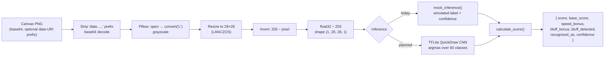

- **Class list:** `QUICKDRAW_CLASSES` contains **60** labels. All 45 game prompts are a subset of them, so every prompt is recognisable by a real model.
- **Mock inference** (`mock_inference`): if the prompt is a known class, confidence is uniform in `[0.45, 0.95]` and 70 % of the time the "AI" returns the prompt; otherwise it returns a random wrong class with confidence in `[0.10, 0.50]`. Because wrong-label confidence never exceeds 0.5, **the +15 bluff bonus cannot trigger under the mock**; it only becomes reachable with the real model.
- **Switching to the real model:** the commented block inside `mock_inference` shows the intended TFLite flow (`Interpreter` → `set_tensor` → `invoke` → `argmax`). See [Roadmap](#17-roadmap).

### 6.3 Prompt pool

45 prompts, chosen at random per room:

`apple, bicycle, bird, book, bridge, butterfly, cake, car, cat, clock, cloud, coffee cup, crown, dog, dolphin, elephant, eye, fish, flower, frog, guitar, hammer, hand, hat, house, ice cream, key, lamp, lion, moon, mountain, mushroom, octopus, pencil, pizza, rabbit, shoe, snake, star, sun, tree, truck, umbrella, whale, zebra`

### 6.4 Winner & stats logic (`submit_score`)

1. Determine whether the submitter is `player1` or `player2`, write the score to `player1_score` / `player2_score`.
2. Re-read the room. If **both** scores are non-null:
   - `winner_id = player1_id if p1 >= p2 else player2_id` (**ties go to Player 1**).
   - Set `status = finished` and `winner_id`.
   - For both players: `total_games += 1`, `total_wins += 1` (winner only), `best_score = max(best_score, score)`.
3. Otherwise return `{"status": "waiting_for_opponent"}`.

---

## 7. Frontend Deep Dive

### 7.1 Routing and auth guard

`main.dart` configures a single top-level `GoRouter` (`initialLocation: /login`). The `redirect` callback checks `SupabaseClientHelper.isLoggedIn` and:

- sends logged-out users to `/login` (except on `/login`, `/register`),
- sends logged-in users on an auth page to `/home`.

Game parameters (`roomCode`, `gameId`, `prompt`, `isPlayer1`, scores) travel as **query parameters**.

### 7.2 Realtime

`SupabaseClientHelper.listenToRoom(roomId, onUpdate)` subscribes to `postgres_changes` (`UPDATE` on `public.game_rooms`, filtered by `id = roomId`). It is used twice:

| Where | Trigger | Effect |
|---|---|---|
| `LobbyScreen` (creator) | `status == 'active'` | Opponent joined → navigate to `/game` |
| `GameScreen` (both) | `status == 'finished'` | Both scores in → navigate to `/result` with winner and scores |

### 7.3 Drawing canvas

`DrawingCanvas` is a `RepaintBoundary` wrapping a `GestureDetector` + `CustomPaint`:

- Strokes are stored as `List<List<DrawingPoint>>` (white, 4 px, round caps/joins on a `#1A1A2E` background).
- `onPanStart` also fires `onDrawingStarted`, which reveals the live AI bar.
- `toBase64()` rasterises the boundary at `pixelRatio: 1.0` to PNG and base64-encodes it for upload.
- `clear()` wipes all strokes.

### 7.4 Game screen behaviour

- A 1-second `Timer.periodic` drives the 60-second countdown; at 0 the drawing is auto-submitted.
- `PromptCard` shows the prompt and a timer that turns green → orange (≤ 30 s) → pink (≤ 10 s).
- `AiScoreBar` shows the "AI sees…" label and a confidence meter.
- The live preview currently **simulates** confidence (see [limitations](#14-current-status--known-limitations)); the authoritative score only comes from the server on submit.

### 7.5 Design system

Dark Material 3 theme with **Poppins**:

| Token | Hex | Used for |
|---|---|---|
| `primary` | `#6C63FF` | Buttons, prompt, room code |
| `secondary` | `#FF6584` | Join action, "lose", bluff state |
| `accent` | `#43E97B` | Win, confidence bar, leaderboard highlights |
| `background` | `#0F0F1A` | Scaffold |
| `surface` / `cardColor` | `#1A1A2E` / `#16213E` | Inputs, canvas / cards |
| `textSecondary` | `#B0B0C8` | Captions |

---

## 8. The Scoring System

```
┌──────────────────────────────────────────────────────────────┐
│                      SCORING BREAKDOWN                       │
├───────────────┬──────────────────────────────────────────────┤
│ Base score    │ confidence × 60                  (max 60)    │
│ Speed bonus   │ max(0, (60 − time_taken) / 60) × 25 (max 25) │
│ Bluff bonus   │ +15 if label ≠ prompt AND confidence > 0.6   │
├───────────────┼──────────────────────────────────────────────┤
│ Total         │ min(100, base + speed + bluff)               │
└───────────────┴──────────────────────────────────────────────┘
```

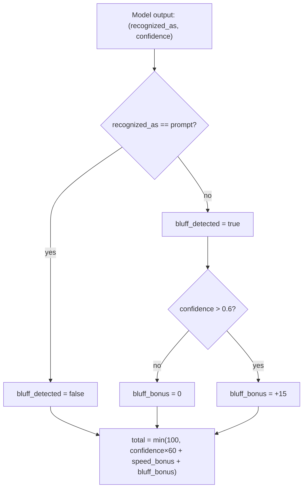

**Worked example** (AI says *"cat"* at 85 % confidence, player submits after 6 s):

| Component | Calculation | Points |
|---|---|---|
| Base | 0.85 × 60 | 51.0 |
| Speed | (60 − 6) / 60 × 25 | 22.5 |
| Bluff | label matches prompt | 0.0 |
| **Total** | | **73.5** |

**Notes on the formula as implemented**

- `bluff_detected` is `true` whenever the recognised label differs from the prompt, even with low confidence. The **+15 bonus**, however, requires confidence > 0.6.
- The base score uses the model's confidence **regardless of which label won**. A confidently *wrong* classification therefore scores base points too. This is the core of the bluff mechanic, and one of the first things to revisit when tuning balance with the real model.
- `time_taken` is reported by the client (see [Security Notes](#15-security-notes)).

---

## 9. API Reference

**Base URL:** `http://localhost:8000/api/v1` (local) · interactive docs at `/docs` (Swagger) and `/redoc`.
Utility endpoints outside the prefix: `GET /` → `{"message": "SketchDuel API is running"}` and `GET /health` → `{"status": "ok"}`.

### Auth

| Method | Endpoint | Body | Description |
|---|---|---|---|
| `POST` | `/auth/register` | `{ email, password, username }` | Creates a Supabase Auth user and a `profiles` row |
| `POST` | `/auth/login` | `{ email, password }` | Returns `{ access_token, token_type: "bearer", user }` |
| `GET` | `/auth/profile/{user_id}` | — | Returns the profile row or `404` |

### Game

| Method | Endpoint | Input | Description |
|---|---|---|---|
| `POST` | `/game/room/create` | query: `player_id` | Creates a room → `{ room_code, game_id, prompt }` |
| `POST` | `/game/room/join` | `{ room_code, player_id }` | Joins a `waiting` room (not your own) and sets it `active`; `404` otherwise |
| `GET` | `/game/room/{room_code}` | — | Full room row |
| `POST` | `/game/score` | `{ game_id, player_id, drawing_data, prompt, time_taken }` | Scores a drawing and persists it |
| `GET` | `/game/history/{user_id}` | — | Last 20 finished games for the user |

### Leaderboard

| Method | Endpoint | Input | Description |
|---|---|---|---|
| `GET` | `/leaderboard/top` | query: `limit` (default `20`) | Players ordered by `total_wins`, with `rank` and `win_rate` |

### Examples

<details>
<summary><b>POST /game/room/create → 200</b></summary>

```json
{
  "room_code": "K7QX2M",
  "game_id": "3f0c6a52-9a1e-4c7b-8d6e-2b1f0a9d1c44",
  "prompt": "umbrella"
}
```
</details>

<details>
<summary><b>POST /game/score → 200 (first player to finish)</b></summary>

```json
{
  "score": 73.5,
  "base_score": 51.0,
  "speed_bonus": 22.5,
  "bluff_bonus": 0.0,
  "bluff_detected": false,
  "recognized_as": "cat",
  "confidence": 0.85,
  "status": "waiting_for_opponent"
}
```

When the second player submits, `status` becomes `"finished"` and a `winner_id` field is included.
</details>

<details>
<summary><b>GET /leaderboard/top → 200</b></summary>

```json
[
  {
    "rank": 1,
    "username": "sketchmaster",
    "total_wins": 12,
    "total_games": 15,
    "win_rate": 80.0,
    "best_score": 91.4
  }
]
```
</details>

---

## 10. Database & Row Level Security

Run this in the **Supabase SQL Editor**:

```sql
create table profiles (
  id uuid references auth.users on delete cascade primary key,
  username text unique not null,
  email text unique not null,
  total_wins integer default 0,
  total_games integer default 0,
  best_score float default 0.0,
  created_at timestamp with time zone default timezone('utc', now())
);

create table game_rooms (
  id uuid default gen_random_uuid() primary key,
  room_code text unique not null,
  prompt text not null,
  status text default 'waiting',
  player1_id uuid references profiles(id),
  player2_id uuid references profiles(id),
  player1_score float,
  player2_score float,
  winner_id uuid references profiles(id),
  created_at timestamp with time zone default timezone('utc', now())
);

alter table profiles enable row level security;
alter table game_rooms enable row level security;

create policy "Profiles are publicly readable"
  on profiles for select using (true);

create policy "Users can update their own profile"
  on profiles for update using (auth.uid() = id);

create policy "Game rooms are publicly readable"
  on game_rooms for select using (true);

create policy "Authenticated users can create rooms"
  on game_rooms for insert with check (auth.role() = 'authenticated');

create policy "Players can update their own room"
  on game_rooms for update using (
    auth.uid() = player1_id or auth.uid() = player2_id
  );

-- Required for the Realtime subscriptions used by the lobby and game screens
alter publication supabase_realtime add table game_rooms;
```

> ⚠️ **RLS and the backend client.** The backend currently talks to Postgres with the **anon** client (`supabase`) for all reads and writes. With the policies above, some of those writes (inserting a `profiles` row on registration, a second player updating a room they aren't yet part of, updating both players' stats) are only allowed for the *service role*. If you hit `new row violates row-level security policy` errors, switch the services to `supabase_admin` (already defined in `core/supabase.py`) or add the corresponding policies. See [Known Limitations](#14-current-status--known-limitations).

Credentials: **Supabase Dashboard → Settings → API** → *Project URL* → `SUPABASE_URL`, *anon public key* → `SUPABASE_KEY` (and the Flutter `supabaseAnonKey`), *service_role key* → `SUPABASE_SERVICE_KEY`.
For local development also turn **off** *Authentication → Providers → Email → Confirm email*.

---

## 11. Getting Started

### Prerequisites

| Tool | Version | Notes |
|---|---|---|
| Python | 3.11+ | The repo's bytecode was generated on 3.13 |
| Flutter | Dart SDK ≥ 3.10.7 | Run `flutter doctor` – no critical issues |
| Git | 2.x | |
| Supabase account | Free | <https://supabase.com> |

### 1. Clone

```bash
git clone https://github.com/MuaazTasawar/sketchduel.git
cd sketchduel
```

### 2. Backend

```powershell
cd backend
python -m venv venv
venv\Scripts\activate           # macOS/Linux: source venv/bin/activate
pip install -r requirements.txt
```

Create `backend/.env` (see [Configuration](#12-configuration)), then:

```powershell
uvicorn app.main:app --reload --port 8000
```

Open <http://localhost:8000/docs> to confirm the endpoints are live.

### 3. Frontend

```powershell
cd frontend
flutter pub get
flutter run -d chrome
```

> Android emulator? Set `baseUrl` to `http://10.0.2.2:8000/api/v1` in `app_constants.dart` (the emulator's alias for your machine's localhost).

### 4. Play a full match locally

1. Register **two** accounts (use a normal and an incognito window for the second player).
2. Player 1 → **Create Room** → copy the 6-character code.
3. Player 2 → **Join Room** → enter the code.
4. Both clients jump to the game screen with the same prompt.
5. Draw, then **Submit** (or let the timer run out).
6. The result screen shows the winner and both scores; check the **Leaderboard**.

---

## 12. Configuration

### Backend – `backend/.env`

```env
SUPABASE_URL=https://<your-project-id>.supabase.co
SUPABASE_KEY=<anon public key>
SUPABASE_SERVICE_KEY=<service role key>      # server-side only, never ship to a client
SECRET_KEY=<long random string>
ENVIRONMENT=development
```

| Variable | Required | Purpose |
|---|---|---|
| `SUPABASE_URL` | ✅ | Project URL |
| `SUPABASE_KEY` | ✅ | Anon key used by `supabase` client |
| `SUPABASE_SERVICE_KEY` | ✅ | Service-role key used by `supabase_admin` |
| `SECRET_KEY` | ✅ | Reserved for token signing (`HS256`, 24 h expiry defaults in `config.py`) |
| `ENVIRONMENT` | ➖ | Defaults to `development` |

### Frontend – `lib/core/constants/app_constants.dart`

```dart
class AppConstants {
  static const String appName = 'SketchDuel';

  // Chrome / Web
  static const String baseUrl = 'http://localhost:8000/api/v1';
  // Android emulator
  // static const String baseUrl = 'http://10.0.2.2:8000/api/v1';
  // Production
  // static const String baseUrl = 'https://<your-service>.onrender.com/api/v1';

  static const String supabaseUrl     = 'https://<your-project-id>.supabase.co';
  static const String supabaseAnonKey = '<anon public key>';

  static const int drawingTimeSeconds = 60;
  static const int maxRoomCodeLength  = 6;
}
```

The **anon** key is designed to be public (it's protected by RLS); the **service-role** key and `SECRET_KEY` must never appear in the Flutter app or in git.

---

## 13. Deployment

### Backend → Render (free)

1. Push the repo to GitHub.
2. Render → **New → Web Service** → connect the repo.
3. **Root directory:** `backend`
4. **Build command:** `pip install -r requirements.txt`
5. **Start command:** `uvicorn app.main:app --host 0.0.0.0 --port $PORT`
6. Add the five environment variables in the Render dashboard.
7. Deploy → `https://<your-service>.onrender.com`

> The free tier sleeps after ~15 minutes idle; the first request afterwards can take ~30 s to wake. Fine for a portfolio demo, but consider pinging `/health` if you need it responsive.

`backend/render.yaml` exists but is empty; the dashboard steps above are the current deployment path. A minimal blueprint would look like:

```yaml
services:
  - type: web
    name: sketchduel-api
    runtime: python
    rootDir: backend
    buildCommand: pip install -r requirements.txt
    startCommand: uvicorn app.main:app --host 0.0.0.0 --port $PORT
    healthCheckPath: /health
    envVars:
      - key: SUPABASE_URL
        sync: false
      - key: SUPABASE_KEY
        sync: false
      - key: SUPABASE_SERVICE_KEY
        sync: false
      - key: SECRET_KEY
        generateValue: true
      - key: ENVIRONMENT
        value: production
```

### Frontend → Vercel (free)

```powershell
cd frontend
flutter build web --release
npm i -g vercel
cd build\web
vercel --prod
```

Update `baseUrl` to the Render URL **before** building, and add the deployed web origin to the CORS list in `backend/app/main.py`.

---

## 14. Current Status & Known Limitations

An honest snapshot, based on reading the source, so you know what is solid and what still needs work.

### ✅ Implemented

- Email/password registration and login (Supabase Auth)
- Room creation with unique code + random prompt, join by code
- Realtime lobby → game → result transitions
- Freehand canvas, 60 s timer with auto-submit, PNG export
- Server-side preprocessing + scoring (base / speed / bluff)
- Winner decision, per-player stats (`total_games`, `total_wins`, `best_score`)
- Global leaderboard with win rate
- Dark themed, animated UI

### ⚠️ Known issues & gaps

| # | Area | Issue | Suggested fix |
|---|---|---|---|
| 1 | **ML** | `mock_inference` returns random results; no model file is bundled. | Add a trained QuickDraw TFLite/ONNX model and load it once at startup. |
| 2 | **ML preprocessing** | The canvas is **white strokes on a dark background**, but preprocessing inverts the image (`255 − x`), producing dark-on-light. QuickDraw expects white-on-black. Non-square canvases are also squashed to 28×28 without cropping to the stroke bounding box. | Remove the inversion (or render black-on-white), crop to bounding box, pad to square, then resize. |
| 3 | **Live AI bar** | The "AI sees…" bar is **simulated** on the client (a deterministic ramp based on elapsed time, label = the prompt). It is not driven by a model. | Run an on-device model or a lightweight `/predict` endpoint every few seconds. |
| 4 | **Create-room call** | `GameRepository.createRoom` issues a **GET** with `?player_id=…`, whereas the backend route is **POST** `/game/room/create`. | Change the repository call to `POST` (query param `player_id`). |
| 5 | **Result screen** | `ResultScreen` assumes the winner is "player 1" when mapping scores (`iWon ? p1Score : p2Score`), and the submit-path redirect passes `myScore` instead of `p1Score`/`p2Score`. Scores may display wrongly for the other player. | Look up whether the current user is player 1 or 2 and map scores accordingly, or re-fetch the room by `gameId`. |
| 6 | **Concurrency** | `submit_score` is read-modify-write across several calls. If both players submit at the same instant, both may observe the other's score as `null` (the match never finishes) or stats may be updated twice. | Move winner/stats finalisation into a single Postgres function (RPC) or use a transaction. |
| 7 | **No server timer** | The 60 s limit is enforced only by each client. A player who never submits leaves the room `active` forever. | Store `started_at`, add a deadline, and auto-forfeit/finish via a scheduled job. |
| 8 | **Shared Supabase client** | `login` calls `sign_in_with_password` on the process-wide `supabase` client, which can store that user's session and affect later requests from other users. | Use per-request clients or `supabase_admin` for server operations. |
| 9 | **RLS vs anon client** | Backend writes use the anon client although some operations violate the stated RLS policies (e.g. no `INSERT` policy on `profiles`). | Use `supabase_admin` in services, or add policies. |
| 10 | **Dependencies** | `requirements.txt` pins both `pydantic==2.11.5` and `pydantic[email]==2.7.1`, which conflict. | Keep a single `pydantic[email]==<version>` pin. |
| 11 | **Flutter assets** | `pubspec.yaml` declares `assets/models/`, but the directory doesn't exist, which can fail `flutter build`/`run`. | Create `frontend/assets/models/` (e.g. with a `.gitkeep`) or remove the entry until the model is added. |
| 12 | **Tests** | `test/widget_test.dart` is the default counter template and references a non-existent `MyApp`. There are no backend tests. | Replace with real widget tests; add `pytest` tests for `calculate_score` and `submit_score`. |
| 13 | **Unused deps** | `provider`, `flutter_drawing_board`, `lottie`, `shared_preferences`, `uuid`, `image`, `fluttertoast` are declared but not used in `lib/`. | Remove or adopt them. |
| 14 | **Display name** | The home screen shows the email prefix instead of the profile `username`. | Fetch the profile via `/auth/profile/{id}`. |

---

## 15. Security Notes

| Topic | Current state | Recommendation |
|---|---|---|
| **Secrets in git** | `backend/.env` is listed in `.gitignore`, but a copy exists in the project archive. | Verify it is not tracked (`git ls-files backend/.env`). If it was ever pushed, **rotate** the service-role key and `SECRET_KEY` in Supabase. |
| **JWT verification** | The client sends `Authorization: Bearer <token>`, but the backend **doesn't validate it**. `player_id` is taken from the request body/query. | Add a FastAPI dependency that verifies the Supabase JWT and derives the user id server-side. |
| **Client-trusted values** | `time_taken` and `prompt` come from the client, so speed bonus and prompt can be forged. | Compute elapsed time from a server-side `started_at`; read the prompt from `game_rooms`. |
| **CORS** | `allow_origins` includes `"*"` together with `allow_credentials=True`. | Restrict to your real origins in production. |
| **Authorisation** | Any caller can read any room, profile or history by id. | Enforce ownership checks / tighten RLS. |
| **Rate limiting** | None; `/game/score` runs image decoding per call. | Add rate limits and a max payload size. |
| **Room codes** | 6 chars from `random.choices`; not cryptographically random, and no explicit collision retry (the DB `UNIQUE` constraint rejects duplicates). | Use `secrets.choice` and retry on conflict. |
| **Stats update** | `total_games`/`total_wins` updated via read-then-write. | Use an atomic SQL increment. |

---

## 16. Troubleshooting

| Problem | Fix |
|---|---|
| `Connection refused` from Flutter | Backend isn't running – start `uvicorn` first. |
| `10.0.2.2` doesn't work | That alias is for the Android emulator only; on Chrome use `localhost`. |
| `email rate limit exceeded` | Disable email confirmation (Auth → Providers → Email) for local dev. |
| `email not confirmed` | Confirm the user manually in Supabase → Authentication → Users. |
| `relation "profiles" does not exist` | Run the [SQL schema](#10-database--row-level-security). |
| `new row violates row-level security policy` | See the RLS note in [§10](#10-database--row-level-security). |
| `405 Method Not Allowed` when creating a room | Known issue #4 (GET vs POST). |
| Lobby never advances after opponent joins | Ensure `alter publication supabase_realtime add table game_rooms;` was run. |
| Flutter CORS error (web) | Add your Flutter dev origin/port to `allow_origins` in `backend/app/main.py`. |
| Port 8000 already in use | `netstat -ano \| findstr :8000` then `taskkill /PID <id> /F` (Windows). |
| `pip` dependency conflict on `pydantic` | See known issue #10. |
| First request on Render takes ~30 s | Free-tier cold start; expected. |

---

## 17. Roadmap

**Near term (make the MVP real)**
- [ ] Replace the mock with a real QuickDraw TFLite/ONNX model and fix preprocessing
- [ ] JWT verification on the backend; derive `player_id` server-side
- [ ] Fix create-room verb mismatch and result-screen score mapping
- [ ] Atomic finish-game logic (Postgres RPC) and server-side match deadline
- [ ] Tests (backend `pytest`, Flutter widget tests) and CI

**Gameplay**
- [ ] Live stroke-by-stroke AI inference
- [ ] Custom prompt packs (Animals, Food, Architecture)
- [ ] Daily global challenge
- [ ] Spectator mode and drawing replay
- [ ] Tournament brackets (4/8 players)
- [ ] Chat and emoji reactions

**Platform**
- [ ] Installable PWA
- [ ] Profile screen and match history UI (the `/game/history/{user_id}` endpoint already exists)
- [ ] Production-ready `render.yaml`

---

## 18. Contributing

```bash
git checkout -b feature/your-feature-name
# make your changes
git commit -m "feat: your feature description"
git push origin feature/your-feature-name
# open a Pull Request
```

Style guidelines:

- **Dart:** `snake_case` filenames, `PascalCase` classes; run `flutter analyze`.
- **Python:** PEP 8; type-hint service functions.
- **Commits:** [Conventional Commits](https://www.conventionalcommits.org/) (`feat:`, `fix:`, `docs:` …).

---

## 19. License

Released under the **MIT License**. Free to use, modify and distribute.

---

<div align="center">

Built with **Flutter**, **FastAPI**, **Supabase**, and a love for tricking neural networks. ✏️

[Report a bug](https://github.com/MuaazTasawar/sketchduel/issues) · [Request a feature](https://github.com/MuaazTasawar/sketchduel/issues)

</div>
